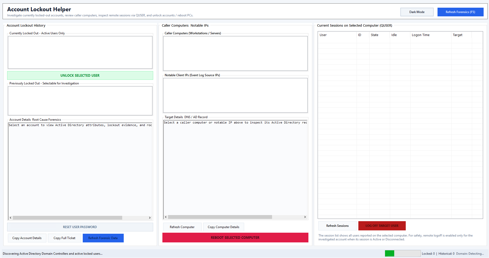
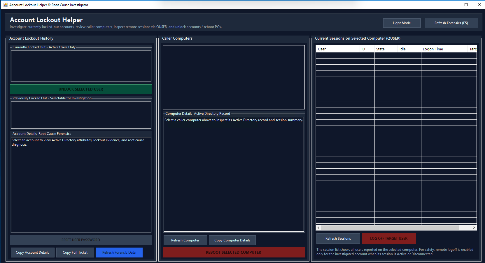

# Domain Account Lockout Helper & Root Cause Investigator

A domain-agnostic, zero-installation administrative troubleshooting tool for Enterprise Windows Active Directory environments. Built specifically for Domain Administrators, Systems Engineers, and IT Support Staff to rapidly investigate, diagnose, and remediate user account lockouts.

### Application User Interface (Light & Dark Mode)

| Light Mode Interface | Dark Mode Interface |
| :---: | :---: |
|  |  |

---

## Key Capabilities

- **Domain Lockout & Password Policy Discovery:**
  - Auto-discovers and displays Domain Lockout Threshold (attempts), Lockout Duration (minutes or manual unlock required), Reset Window (minutes), Maximum Password Age (days), and Minimum Password Length directly in the UI and report.

- **Deep User Account Security Attributes & Timestamps:**
  - Evaluates user security attributes via native LDAP:
    - **Password Last Set:** Displays exact timestamp and calculates relative elapsed time (e.g. `14.2 hours ago - RECENT CHANGE`).
    - **Password Expiration:** Identifies whether the account is subject to domain password aging or has `Password Never Expires` enabled.
    - **Last Bad Password Attempt:** Displays timestamp and the current `badPwdCount` tally.
    - **Last Successful Domain Logon:** Extracts `lastLogonTimestamp`.
    - **Account Expiration:** Reports account expiration date or `Never`.
    - **Primary Security Groups:** Lists user's top group memberships (`memberOf`).

- **Smoking-Gun Diagnosis Engine:**
  - Correlates the user's `pwdLastSet` timestamp against security log lockout events.
  - When a user updated their password within the last 72 hours and lockouts occurred *after* that timestamp, the tool flags `[CONFIRMED STALE CREDENTIALS]` and isolates the offending caller machines or wireless profiles that are authenticating with the old password.

- **Unlock Accountability & Tracking (Event ID 4767):**
  - Scans Domain Controller Security logs for Event ID 4767 (*"A user account was unlocked"*).
  - Identifies exactly who performed prior account unlocks (`SubjectUserName` and `SubjectDomainName`), the Domain Controller that processed it, and the exact timestamp.
  - Queries natively via targeted read-only Event Log XPath readers without triggering SentinelOne or EDR reconnaissance alerts.

- **Enterprise 802.1X Wi-Fi & NPS / RADIUS Proxy Playbook:**
  - Detects when caller devices point to an authentication proxy (such as Microsoft Network Policy Server / NPS).
  - Outlines the step-by-step procedure to inspect NPS Event ID 6273 on the NPS server to retrieve the physical device's hardware MAC address (`Calling-Station-Id`) and Wi-Fi Access Point location (`Client-Friendly-Name`).


- **Caller Host Connectivity & DNS Resolution:**
  - Runs a fast ICMP Ping test (1000ms timeout) reporting online status and roundtrip latency.
  - Resolves host DNS IPv4/IPv6 addresses and verifies network reachability without triggering EDR computer object discovery alerts.

- **Strict Active vs. Historical Separation:**
  - **Currently Locked Out:** Evaluates Active Directory Service Interfaces (`IsAccountLocked`) and domain lockout duration policies to display *only* users who are actively locked out right now.
  - **Previously Locked Out (Forensic History):** Displays enabled accounts that experienced recent lockout events (`Event ID 4740`) but were subsequently unlocked or had their lockout duration expire. Accounts with **0 events** are excluded to eliminate clutter and focus exclusively on recent issues.
  - **Disabled Account Exclusion:** Accounts with the Active Directory `ACCOUNTDISABLE` flag (`userAccountControl` bit 2) are filtered out from both lists.

- **Remote Workstation Session Management (QUSER):**
  - Connects to any caller computer and retrieves all active and disconnected user sessions via `quser.exe`.
  - Enables domain administrators to safely log off the offending session or remotely reboot the workstation.

- **One-Click Account Unlock & Password Reset:**
  - Unlocks user accounts directly across the domain's Primary Domain Controller (PDC) emulator.
  - Prompts to immediately reset the user's password if requested, with options to require a password change at next logon.

- **Global Dark Mode Theme Toggle:**
  - Includes a global Dark Mode theme toggle designed for server rooms and data centers.

- **100% Offline & Deterministic -- CIPA / FERPA / COPPA / HIPAA Compliant:**
  - Root cause diagnostics operate entirely through deterministic offline rules evaluating Windows Security Event ID 4740, NTSTATUS codes, and LDAP attributes.
  - Authentication logs, user SAMAccountNames, computer hostnames, and IP addresses never leave the administrator's local machine or domain boundary.

---

## Zero-Dependency Architecture & Portability

### System Requirements & Permissions
- **Environment:** Must be executed on a **domain-joined Windows machine** with network connectivity to the domain controllers.
- **Permissions:** Must be run with **Domain Administrator** (or equivalent) credentials to successfully query Domain Controller Security Event Logs, reset user passwords, and perform account unlocks.
- **RSAT:** Zero external RSAT installation required; uses native .NET interfaces.

---

### Distribution Files
| File | Description |
| :--- | :--- |
| **`Build-Executable.cmd`** | The single one-click compiler script that compiles `Program-Code.cs` into `AccountLockoutHelper.exe` using the built-in Windows `.NET` C# compiler (`csc.exe`). |
| **`Program-Code.cs`** | Pure C# source code utilizing standard .NET Framework libraries (`System.DirectoryServices`, `System.Windows.Forms`). |

---

## How to Build & Run

### Step 1: Run `Build-Executable.cmd` to Compile
1. Double-click **`Build-Executable.cmd`** in the repository directory.
2. The script locates the built-in Microsoft .NET C# compiler (`csc.exe`) and compiles `Program-Code.cs` into `AccountLockoutHelper.exe` in ~2 seconds.
3. Once compilation finishes, the script asks if you want to launch `AccountLockoutHelper.exe` immediately!

### Step 2: Run or Distribute `AccountLockoutHelper.exe`
1. Double-click the generated **`AccountLockoutHelper.exe`**.
2. The native application launches immediately on screen.
3. **Standalone Deployment Note:** Once compiled, **only `AccountLockoutHelper.exe` is required**. You can copy just the `.exe` file to a network share, USB flash drive, or any domain-joined PC. All source files (`.cs`), build scripts (`.cmd`), and documentation can be left behind or deleted. It runs as a single, self-contained portable executable with zero dependencies or installation required!

### Manual Compilation (Alternative)
If you prefer to compile manually from Command Prompt or PowerShell:
```cmd
%SystemRoot%\Microsoft.NET\Framework64\v4.0.30319\csc.exe /target:winexe /out:AccountLockoutHelper.exe Program-Code.cs
```

---

## Active Directory Forensics & Auditing Details

### Why Traditional LDAP Scripts Report False Positives
In Active Directory, when an account exceeds the lockout threshold, AD sets the `lockoutTime` LargeInteger timestamp. When the domain lockout duration (e.g., 30 minutes) passes, **Active Directory does NOT reset `lockoutTime` to 0**. Instead, the timestamp remains until the user successfully authenticates again or an administrator clears it.

A standard LDAP query for `(lockoutTime>=1)` will return hundreds of unlocked users whose lockouts expired days, weeks, or months ago.

**How Domain Lockout Helper Solves This:**
1. Queries Active Directory using ADSI / DirectoryEntry and invokes `InvokeGet("IsAccountLocked")` (or `UserPrincipal.IsAccountLockedOut()`).
2. Compares the `lockoutTime` against domain password policy (`lockoutDuration`).
3. Cross-references Security Log `Event ID 4740` from all domain controllers.
4. If a user is not actively locked and has **0 recent lockout events**, they are excluded from the investigation lists.

### Security Event IDs Monitored
- **Event ID 4740 (Security Log):** A user account was locked out (captures `TargetUserName`, `CallerComputerName`, domain controller name, and exact event timestamp). Focuses strictly on Event 4740 to prevent EDR/SentinelOne false positives and ensure 100% reliable execution across all domain environments.

### Permissions Required
- **Domain Administrators** OR
- Delegated account with:
  - Read permissions on Active Directory user and computer objects.
  - Read permissions on Domain Controller `Security` Event Logs (`Event Log Readers` built-in domain group).
  - Reset Password / Lockout permissions on targeted Organizational Units (OUs).
  - RPC access (`TCP 135` and dynamic RPC ports) for remote `quser` and `shutdown.exe /m`.

---

## Common Incident Troubleshooting Guide

### Scenario 1: Confirmed Stale Credentials Following Password Change
**Root Cause:** The user updated their password within the past 1-3 days. A secondary device (smartphone Wi-Fi profile, tablet, secondary laptop, or mapped drive) continues submitting authentication requests with the old password.
**Remediation Steps:**
1. Select the user in **Previously Locked Out** or **Currently Locked Out**.
2. Note the `[CONFIRMED STALE CREDENTIALS]` banner showing when the password was changed.
3. Review caller computer(s) and client IP(s) in the middle column.
4. If a workstation is listed, clear stored credentials in Windows Credential Manager and run `klist purge`.
5. If a mobile device IP or wireless server is listed, have the user tap **Forget Network** in Wi-Fi settings and re-authenticate.
6. Click **Unlock Selected User**.

### Scenario 2: Stale Session on Multi-User Workstation
**Root Cause:** A user session was left active or disconnected on a shared computer. Background tasks continue attempting authentication with expired credentials.
**Remediation Steps:**
1. Under **Caller Computers**, select the identified workstation.
2. Under **Current Sessions (QUSER)**, select the user's active or disconnected session.
3. Click **Log Off User Session** (or **Reboot PC** if the host is unresponsive).
4. Unlock the account once the session terminates.

### Scenario 3: Enterprise 802.1X Wireless Credential Loop
**Root Cause:** A mobile device or secondary laptop with stale credentials repeatedly attempts Wi-Fi association against RADIUS/NPS.
**Remediation Steps:**
1. Under **Caller Computers & Client IPs**, observe the RADIUS server or client IP.
2. Have the user select **Forget Network** on their mobile device.
3. Unlock the account.
4. Have the user reconnect with their current password.

---

## Disclaimer & Limitation of Liability

**USE ENTIRELY AT YOUR OWN RISK. THIS SOFTWARE IS PROVIDED "AS IS" WITHOUT WARRANTY OF ANY KIND.**

* **Universal Blanket Disclaimer:** The author(s) and contributor(s) accept **ABSOLUTELY ZERO RESPONSIBILITY OR LIABILITY WHATSOEVER FOR ANY AND ALL ACTIONS, ERRORS, OPERATIONS, OR OUTCOMES THIS PROGRAM COULD POSSIBLY PERFORM, TRIGGER, OR CAUSE**.
* **Covers Any Action Whatsoever:** This applies without limitation to any password reset, account unlock, account lockout, attribute modification, server or host reboot/shutdown, session termination, process logoff, directory query, network scan, data corruption, database downtime, outage, operating system crash, or business interruption against any machine or account. Any examples mentioned are non-exhaustive illustrations only.
* **100% Operator Responsibility:** It is the exclusive responsibility of the operator, administrator, or organization executing this code to review all scripts and source files prior to execution. You assume 100% of all legal, technical, and operational risk.
* **No Maintenance or Support SLA:** This utility is released on a strict "take it or leave it" basis. The author has zero obligation to answer inquiries, patch bugs, or maintain the project.


---

## License & Commercial Use Policy

This project is licensed under the **Apache License, Version 2.0**.
* **Free & Open Source:** Free to download, inspect, fork, and modify. Keep it open source!
* **Paid & Commercial Software Policy (GitHub Shout-Out):** If you use any part of this code in a paid or commercial software product, all you have to do is drop a quick mention / shout-out on the project's **GitHub repository** (via GitHub Discussions or an Issue) letting us know what product is using it. **You do NOT need to wait for permission or a response**—it is completely open source, so you can proceed immediately.
* **Zero Liability & Warranty Disclaimer:** Subject to the strict disclaimers set forth in [DISCLAIMER.md](DISCLAIMER.md), [NOTICE](NOTICE), and Sections 7 & 8 of the Apache License 2.0. Use 100% at your own risk.

